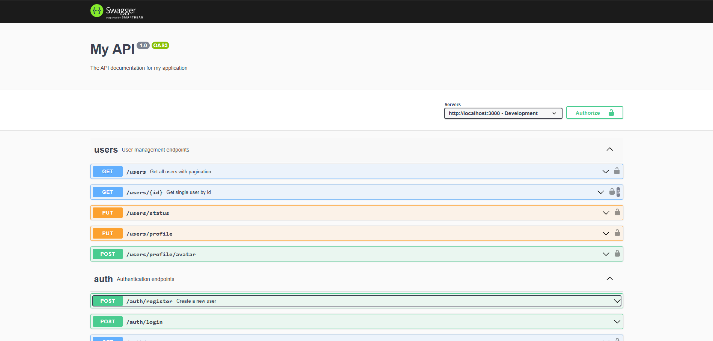

<p align="center">
  
</p>

# Chat Application Backend

A real-time chat application backend built with NestJS, TypeORM, PostgreSQL, and Socket.IO.

## Features

- User authentication with JWT
- Role-based access control
- Real-time messaging with Socket.IO
- PostgreSQL database with TypeORM
- API documentation with Swagger
- Docker support for easy deployment

## API Endpoints

Please refer to [END_POINT.md](END_POINT.md) for the complete list of REST endpoints and WebSocket events.

---

## Running with Docker (Recommended)

This is the easiest way to get up and running — no local PostgreSQL install needed.

### Prerequisites

- [Docker Desktop](https://www.docker.com/products/docker-desktop/)

### Steps

**1. Copy the environment file**

```bash
cp .env.example .env
```

Update `.env` with your desired values (at minimum, set a strong `JWT_SECRET` and `DB_PASSWORD`):

```env
DB_HOST=localhost        # leave as-is; Docker overrides this automatically
DB_PORT=5432
DB_USERNAME=postgres
DB_PASSWORD=yourpassword
DB_DATABASE=chat-app
NODE_ENV=development
PORT=3000
JWT_SECRET=your-secret-key
JWT_EXPIRES_IN=1d
```

**2. Start all services**

```bash
docker compose up
```

This starts:
- `api` — the NestJS app on port `3000` (with hot reload)
- `db` — PostgreSQL 14 on port `5432`

> First run will build the image and pull PostgreSQL, which takes a minute.

**3. Run database migrations**

In a separate terminal, once the containers are up:

```bash
docker compose exec api npm run migration:run
```

**4. Access the app**

| Service        | URL                              |
|----------------|----------------------------------|
| REST API       | http://localhost:3000/api        |
| Swagger docs   | http://localhost:3000/api-docs   |
| PostgreSQL     | localhost:5432                   |

**5. Stop the containers**

```bash
docker compose down
```

To also delete the database volume (fresh start):

```bash
docker compose down -v
```

### Common Docker commands

```bash
# View logs
docker compose logs -f api

# Restart just the API (after config changes)
docker compose restart api

# Open a shell inside the API container
docker compose exec api sh

# Run migrations
docker compose exec api npm run migration:run

# Revert last migration
docker compose exec api npm run migration:revert
```

---

## Running Locally (without Docker)

### Prerequisites

- Node.js v20+
- PostgreSQL running locally
- npm

### Setup

**1. Install dependencies**

```bash
npm install
```

**2. Configure environment**

```bash
cp .env.example .env
```

Update `.env` — keep `DB_HOST=localhost` for local development.

**3. Run migrations**

```bash
npm run migration:run
```

**4. Start the app**

```bash
# development with hot reload
npm run start:dev

# production
npm run start:prod
```

---

## Database Migrations

```bash
# generate a new migration (after changing entities)
npm run migration:generate

# run pending migrations
npm run migration:run

# revert last migration
npm run migration:revert

# show migration status
npm run migration:show
```

## Testing

```bash
# unit tests
npm run test

# e2e tests
npm run test:e2e

# test coverage
npm run test:cov
```

## API Documentation

Once the app is running, Swagger UI is available at:

```
http://localhost:3000/api-docs
```



## Project Structure

```
src/
├── auth/           # Authentication module
├── users/          # User management module
├── config/         # Configuration files
├── migrations/     # Database migrations
└── main.ts         # Application entry point

docs/
└── images/         # Documentation images and screenshots

public/
└── uploads/        # User uploaded files
    ├── profile-pictures/
    ├── attachments/
    └── thumbnails/
```

## License

This project is [MIT licensed](LICENSE).
